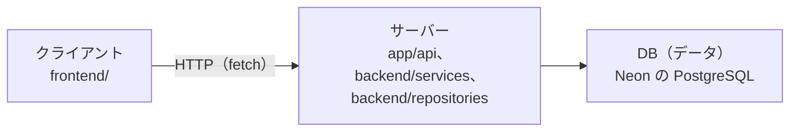

# 指定緊急避難場所の一覧（学習用・DB版）

指定緊急避難場所の一覧を見せる、小さなアプリです。Next.js 16.4.6 で作っています。
データは **架空のサンプルデータ** です（自治体標準オープンデータセットの形をしています）。

このアプリで学ぶのは、バックエンドとDBのつなぎ方です。画面とサーバーの作りは、JSON ファイルの版（opendata-app）と同じです。違うのは、データを JSON ファイルではなく DB（Neon の PostgreSQL）から読むところだけです。

| | JSON ファイルの版（opendata-app） | DB版（このアプリ） |
|---|---|---|
| データの置き場所 | `data/shelters.json` | Neon の PostgreSQL の `shelters` の表 |
| データを読むファイル | `backend/repositories/shelterRepository.ts` | 同じファイル（中身だけが違う） |
| データを直したとき | 公開し直すまで、公開先の表示は変わらない | 公開し直さなくても、公開先の表示が変わる |

## 3つの層



くわしい決まりは [CLAUDE.md](./CLAUDE.md) にあります。Claude Code でこのアプリを広げるときも、このファイルを読んで進めます。

## 動かしてみる

Node.js 20.9 以上が必要です。DB は Vercel から作るので、先に Vercel に公開します。

1. このフォルダを自分の GitHub のリポジトリに送り、Vercel に公開します（Add New → Project → Import Git Repository の一覧から Import → Deploy）。この時点では DB がないので、一覧には「通信に失敗しました（500）」と出ます
2. Vercel のプロジェクトの左のメニューの Storage → Create Database → Neon を選び、DB を作ってこのプロジェクトにつなぎます。Auth はオフ、Connect a Project の画面の Custom Prefix は `DATABASE` にします。環境変数 `DATABASE_URL` が自動で入ります
3. 手元にも `DATABASE_URL` を持ってきます。DB の画面の Quickstart で `.env.local` のタブを選び、Show secret → Copy Snippet を押してから、このフォルダで次を打ちます

```bash
pbpaste > .env.local
```

4. DB に表を作り、`data/shelters.json` の14件を入れます

```bash
npm install
```

```bash
npm run db:seed
```

「shelters の表に 14 件あります。」と出れば完了です。DB の画面の Data Editor で、14行の表が見られます。

5. 公開し直します。環境変数は、足したあとの公開から使われるためです。Deployments のいちばん上の行の「…」から Redeploy を押すと、公開先に一覧が出ます

6. 手元で動かします

```bash
npm run dev
```

ブラウザで http://localhost:3000 を開きます。公開先と同じ一覧が出ます（同じ DB を見ているため）。

## DB から読んでいるかを確かめる

DB の画面の Data Editor で `shelters` の表を開き、id が `sample-001` の行の name を「サンプル第一小学校（DBから）」に書き換えて保存します。

手元と公開先のどちらも、再読み込みで名前が変わります。公開し直していないのに変わるのは、データがコードと別の場所（DB）にあるためです。戻すときは、同じように書き換えるか、`npm run db:seed` をもう一度動かします。

SQL で直すときは、DB の画面の Query で右上の Read-only をオフにしてから、次の1行を Run します。

```sql
UPDATE shelters SET name = 'サンプル第一小学校（DBから）' WHERE id = 'sample-001';
```

## APIを見てみる

ブラウザで次のURLを開くと、バックエンドが返すデータが見えます。

- http://localhost:3000/api/shelters （全件）
- http://localhost:3000/api/shelters?hazard=tsunami （津波に対応する場所だけ）
- http://localhost:3000/api/shelters?q=体育館 （名前か住所に「体育館」を含む場所）

## 練習問題

| 内容 | 難しさ | 触る層 |
|---|---|---|
| Neon の SQL Editor で、避難場所を1件足す | やさしい | DB だけ（コードは触らない） |
| 災害の種類で絞り込むボタンを作る | やさしい | フロントだけ |
| 新しい項目（開設時間など）を表の列に足して表示する | ふつう | shared、`scripts/seed-db.mjs`、repository、フロント |
| 並べ替え（収容人数順）をAPIに足す | ふつう | バックエンドとフロント |
| 画面から避難場所を足せるようにする | むずかしい | フロント、API（POST）、service、repository |

進めたあとは、必ず `npm run check` を通します。

## コマンド

| コマンド | 何をするか |
|---|---|
| `npm run dev` | 開発用サーバーを起動 |
| `npm run lint` | コードの決まりを調べる（層の境界も） |
| `npm run check` | lint、型チェック、ビルドをまとめて実行 |
| `npm run db:seed` | `data/shelters.json` の中身を DB に入れる。表がなければ作る。何度動かしてもよい |

## 接続先の扱い

`DATABASE_URL` には、DB の住所と合言葉が入っています。`.env.local` は GitHub に送らない設定にしてあります（`.gitignore` の `.env*`）。人に見せたり、コードに直接書いたりしません。

## データについて

[data/README.md](./data/README.md) を見てください。DB に入れる元のデータは `data/shelters.json` です。
